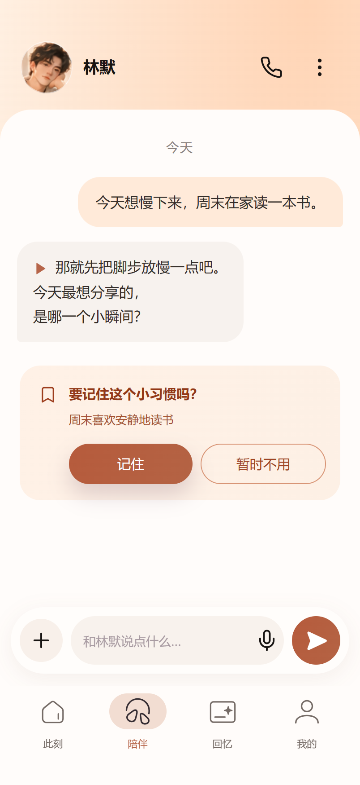
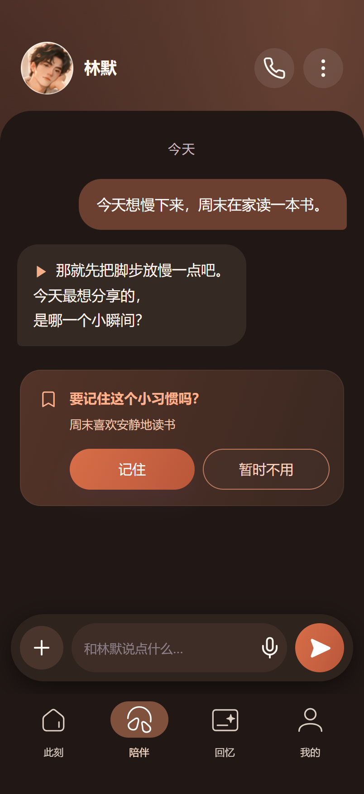
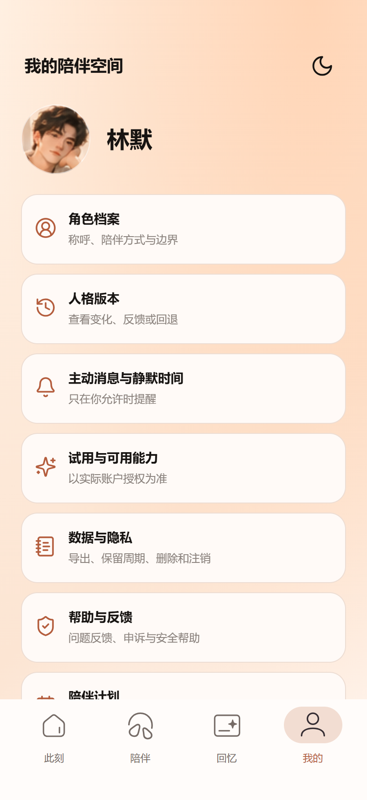
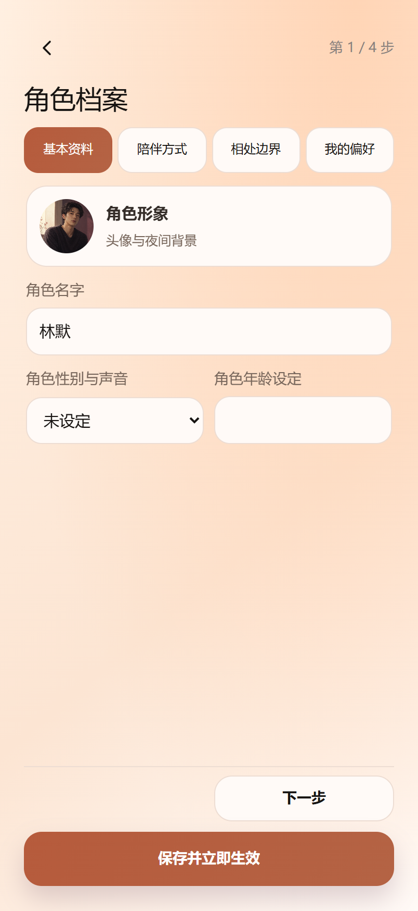
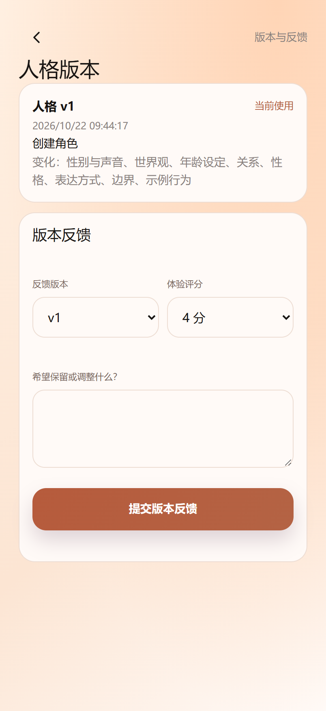
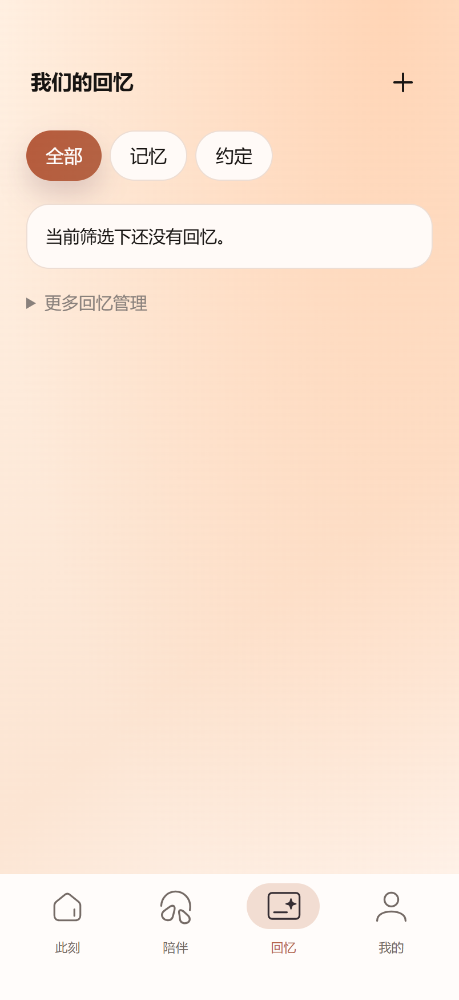
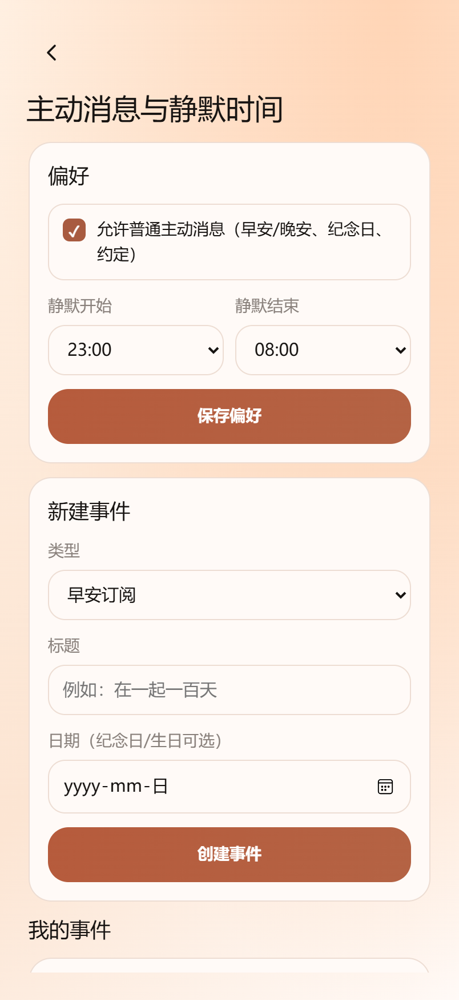
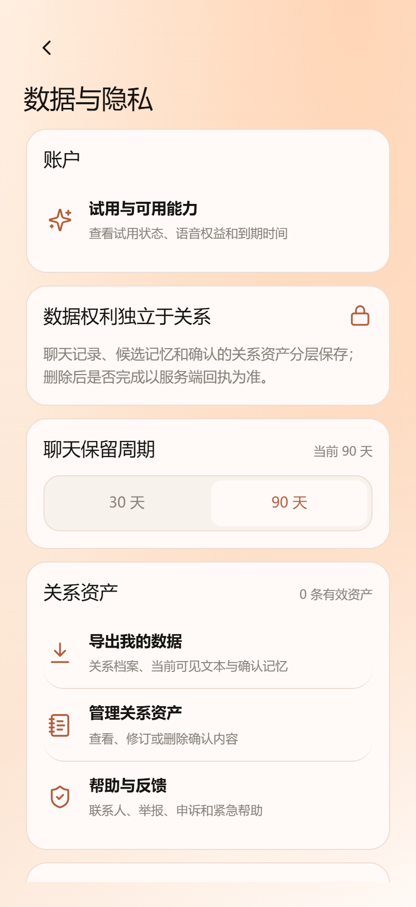

# 栖语 · AI 陪伴

一段由用户掌控、可以查看、修正和延续的角色关系。

栖语面向成年用户，围绕单角色陪伴，提供文字交流、语音陪伴、确认式关系记忆、人格版本与数据控制。界面采用已定版的「杏桃微光」：温暖、安静、克制，四个入口为「此刻、陪伴、回忆、我的」。

[访问邀请封测](https://qiyu.qualisense.top/) · [当前状态](development/CURRENT_PRODUCT_STATUS.md) · [文档导航](docs/README.md) · [设计规范](DESIGN.md)

> 当前是邀请制封闭测试，不是正式公开运营。需要独立签发的邀请码；本仓库不提供可用凭据。不接真实支付或第三方增强年龄核验，不以工程测试代替法律意见、长期用户效果或全设备验收。

## 产品界面

2026-10-22 从当前 v32 真实前端重拍，使用本地一次性合成账号和确定性回复；不是原型截图或真实用户聊天。语音入口展示不代表本轮已调用语音供应商。来源和复现方法见[截图说明](docs/screenshots/README.md)。

| 此刻 | 陪伴 · 日间 | 陪伴 · 夜间 |
| --- | --- | --- |
|  |  |  |

| 我的 | 角色档案 | 人格版本 |
| --- | --- | --- |
|  |  |  |

| 回忆 | 语音通话（本地 Mock） | 站内通知 |
| --- | --- | --- |
|  |  |  |

| 陪伴选项 | 主动消息与静默时间 | 数据与隐私 |
| --- | --- | --- |
|  |  |  |

## 当前能力

- 角色与人格：单选模板、角色形象、四步档案、偏好、变化记录、反馈；历史回退从服务端快照创建新生效版本，保留历史与乐观锁。
- 陪伴：文字/SSE、语音转写回填、消息朗读、受控实时语音、情境图片链路；可用性由服务端配置和账户权限决定。
- 关系连续性：候选记忆由用户确认后才生效；可查看来源、纠正、撤销；生活事件、许可内跟进、共同计划和成果卡片受确定性权限控制。
- 用户控制：站内通知、静默时间、暂停、数据导出、保留周期、删除与注销；数据权利不依附订阅权益。

默认本地运行使用内存与 Mock。显式配置可接 PostgreSQL、Qwen、腾讯云媒体/审核与火山实时语音适配器；有代码不等于供应商、效果、运营或合规门禁已经通过。详细范围见[当前状态](development/CURRENT_PRODUCT_STATUS.md)。

## 本地运行

需要 Node.js 22+；首次安装依赖：

```powershell
cd apps/api
npm ci
npm start
```

打开 `http://127.0.0.1:3000/`，按告知、年龄声明、角色创建进入产品。默认没有真实模型、语音外呼或支付。

直接查看已创建合成角色的杏桃界面：

```powershell
node apps/api/scripts/start-apricot-preview.js
```

打开 `http://127.0.0.1:4314/`。它需要进程持续运行；内存数据在退出后重置。`127.0.0.1` 只指访问设备本机，不是可对外分享的线上地址。

## 开发、验证与部署

```powershell
cd apps/api
npm test
npm run test:e2e-browser
node scripts/verify-chat-menu-layout.js
node scripts/capture-product-screenshots.js
```

浏览器脚本使用隔离的 Microsoft Edge 和本地合成服务。PostgreSQL 回归需专属测试库；缺少环境会明确跳过，不算通过。截图默认输出到 Git 忽略的 `output/playwright/`；检查后加 `--publish` 更新仓库截图。

| 入口 | 内容 |
| --- | --- |
| [PRD](栖语PRD_v1.3.md) / [技术设计](栖语技术设计文档_v1.md) | 产品目标、当前封测增量、公开 V1 门禁与系统约束 |
| [API](apps/api/README.md) / [Web](apps/web/README.md) / [OpenAPI](contracts/openapi.yaml) | 运行、同源接口、真实状态边界 |
| [数据库](infra/postgres/README.md) / [部署](deploy/README.md) / [运维](development/OPERATIONS_RUNBOOK.md) | 迁移、RLS、备份与回滚、故障排查 |
| [评测](development/eval/EVAL_BASELINE.md) / [本轮验证](development/eval/github-sync-2026-10-22.md) | 命令、实跑结果、跳过项与未验证项 |
| [设计规范](DESIGN.md) / [视觉 QA](design-qa.md) | 当前设计规则、页面归属与全状态检查 |

## 贡献与发布边界

不提交 `.env`、邀请码、会话令牌、供应商密钥、真实用户数据、数据库备份或原始调试输出。历史原型和按日期命名的报告保留其原始证据范围，不作为当前视觉或运行状态。正式生产启动保护仍保留，不能通过关闭审核或修改环境名来冒充验收完成。
